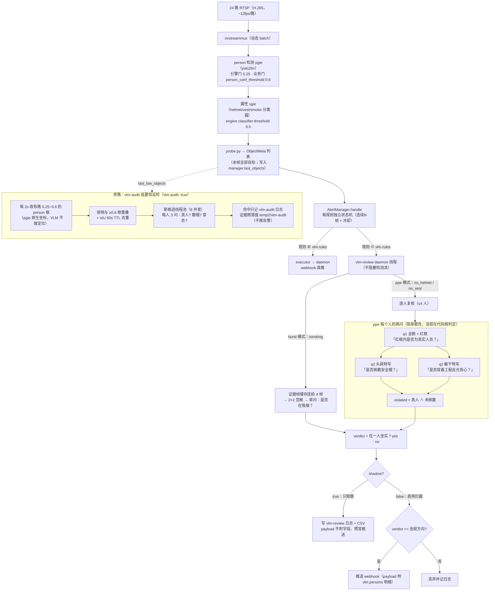
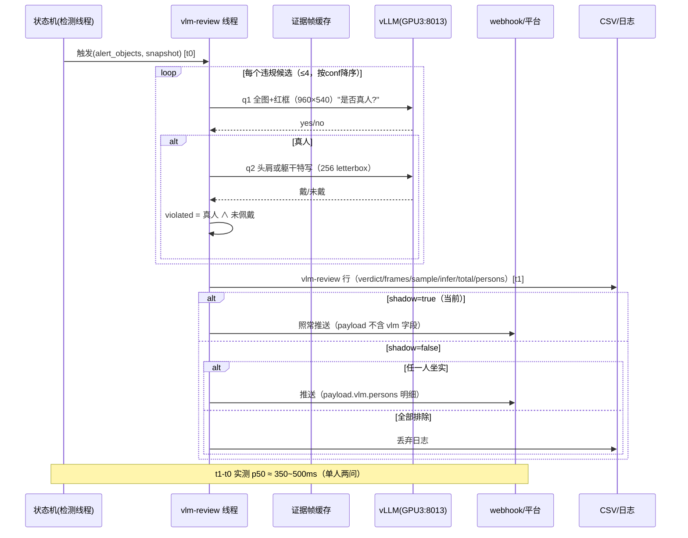

# VLM 复核 v3 架构（可视化说明）

> 方案名：**部件问句 + 逐人复核 + 低置信巡检（框驱动）**
> 状态：已部署（2026-10-30 10:47 重建），运行于 **shadow 观察期**（只记日志，不改变平台收到的告警）
> 本文配套代码：`server/alert/vlm_review.py`、`server/alert/manager.py`、`server/alert/vlm_audit.py`
> 本文配套配置文件：`deploy/config.yaml` 的 `vlm:` 节

---

## 1. 总览（数据流）



<details>
<summary>纯文本版（不支持 Mermaid 的环境看这个）</summary>

```
24路RTSP → nvstreammux → person pgie(0.25/业务门0.6) → 属性sgie(0.5) → probe.py(ObjectMeta)
   → AlertManager.handle（规则独立状态机：连续N帧+冷却）
        ├─ 规则不在 vlm.rules → executor → daemon → webhook 直推
        └─ 规则在 vlm.rules → vlm-review 线程
              ├─ smoking: 连拍4帧 → 拼宫格 → 问"是否在吸烟" → verdict
              └─ no_helmet/no_vest: 逐人(≤4)
                    q1 全图+红框 → "是真人吗?"
                    q2 头肩/躯干特写 → "戴帽/穿衣了吗?"
                    violation = 真人 ∧ 未佩戴
              → verdict = 任一人坐实? yes : no
              → shadow? 只记日志 : 按 verdict 门控推送(payload.vlm.persons)

旁路: vlm-audit 低置信巡检（默认开）每 2s 收各路 0.25~0.6 的 person 框（VLM 不做定位）
      → 排除与 ≥0.6 框重叠 + IoU 60s TTL 去重 → 线程池 8 并发：判人→判帽→判衣
      → 命中只记 vlm-audit 日志 + 证据图落盘 temp2/vlm-audit（不推告警）
```
</details>

---

## 2. 一次 PPE 告警的时序（含时延观测点）



---

## 3. 三层判定逻辑（为什么这么设计）

| 层 | 组件 | 职责 | 失败方向 |
| :--- | :--- | :--- | :--- |
| L1 初筛 | DeepStream 小模型 + 状态机 | 每帧全画面、实时、给出候选框 | 漏检（nano 小目标/重叠）· 误报（护栏当人） |
| L2 复核 | Qwen2.5-VL-7B-AWQ（v3 部件问句） | 逐人判"真人？戴/穿了？" | 单 token 边界抖动 |
| L3 低置信巡检 | vlm-audit（可选） | 2s 采集 0.25~0.6 框，VLM 判人/判穿戴（不做定位） | 单 token 抖动；定位由 L1 提供 |

**关键设计决策（都有实测依据）**：
1. **简单极性问句**（v2 的复合问句"未戴→yes"被 7B 模型按直觉反答：考卷 66.7% → 废弃）；
2. **判人看全图+红框**（孤立裁剪图上问"是否真人"不可靠）；
3. **判帽/判衣看部位特写**（全人 256px 里帽子只有几十像素）；
4. **裁剪必须等比 letterbox**（直接拉伸会把戴帽判成没戴，同字节重放 5/5 复现）；
5. **VLM 不做定位（2026-10-30 定稿）**：旧"全屏点名"方案实测把配电箱/护栏框成"人"且判人级无法否决（同模型自证），已否决；巡检改为消费 pgie 的 0.25~0.6 真实框，定位交回小模型。
6. **PPE 问句必须用对齐句式 + 业务判据**（2026-10-30 两轮实测）：(a) "是否佩戴…？"句式系统性偏否（头部 19/19、躯干 20/20 误答"未戴/未穿"，自由描述却能说出"安全帽/反光背心"），对齐句式修复；(b) 在句式之上加业务定义（硬壳帽才算、草帽/布帽不算；反光条背心才算）**比简短版更准**：40 张头肩图详细版 33/33 vs 简短版 32/33（错例正是"草帽"）；反光衣两版打平，但详细版修复 2 例"白T恤被当背心"的误判。旧复合问句常量（HELMET/VEST_PROMPT）已删除。判人问句保持原句式（对齐句式会让模型复述题目）。
7. **裁剪几何与反光衣定义（2026-10-30 业务确认）**：反光衣定义改为"**带反光条的反光工作服，颜色深浅不限，背心/马甲/长袖/短袖均可**；无任何反光条的普通衣物不算"（旧定义误把带反光条的短袖工作衫判为未穿）。`torso_crop` 纵向 10%→100%、横向 ±20% 收窄为 0；`head_crop` 纵向保持 -10%→45%、横向收窄为 0。**躯干特写升到 512px（放大用 LANCZOS）**：实测 256px 下黄色工装的灰色反光条不可见（判 no），512px 可稳定判 yes；纯黑/白/浅蓝纯色衬衫仍判 no（无误收）；浅绿长袖的低对比灰带在 512 仍不可见（已知边界）。试过"反光条可能与衣服同色、请仔细寻找"的提示词：白衬衫被误判为反光衣（危险方向），已否决。头盔问句保留"防晒帽檐/披肩/护颈加装在硬壳帽上也算，正/侧/背面适用"；**已知边界**：红头巾等软质包头可能被误判为"戴帽"（165011），加"布质不算"会误伤防晒帽檐（实测 2 例翻 no），暂不采纳。**重跑注意**：离线重跑必须用原始分辨率全帧（`_frame.jpg` 现为 1080p）；用 960×540 降采样帧会把"安全帽"看成"草帽"（165141），结论不可用。

---

## 4. 数据契约

**日志行**（`deploy/logs/server.log`，loguru JSON）：
```
vlm-review camera=.. rule=.. verdict=yes|no|skipped frames=N sample=Xms infer=Yms total=Zms persons=P
```
**payload**（非 shadow 才附）：
```json
"vlm": {"verdict":"yes","model":"...","frames":2,
        "persons":[{"conf":0.82,"person":"yes","wearing":"no","violated":true,"ms":210}]}
```
**观察 CSV**（systemd 服务 `vlm-watch` 自动写）：
- 复核：`proposals/vlm-review/vlm-review-result.csv`
  列：北京时间 · camera · rule · verdict · 结果(✓确认/✗排除/∅跳) · frames · sample_ms · infer_ms · total_ms
- 巡检：`proposals/vlm-review/vlm-audit-result.csv`
  列：北京时间 · camera · rule · person · wearing · bbox_x1~y2 · 图前缀（命中证据图在 temp2/vlm-audit/）

---

## 5. 配置开关（`deploy/config.yaml` → `vlm:`）

| 键 | 现值 | 说明 | 回退效果 |
| :--- | :--- | :--- | :--- |
| `enabled` | true | 复核总开关 | false = 完全回到无复核直推 |
| `shadow` | **true** | 只观察不拦截 | false = 开始按大模型结论拦告警 |
| `rules` | smoking, no_helmet, no_vest | 走复核的规则 | `[]` = 全部直推 |
| `timeout` | 2 | 单次 HTTP 上限（秒） | fail_open 时照推，verdict=skipped |
| `fail_open` | true | 大模型不可用时是否照推 | false = 宁可不推也不误推 |
| `sample_ms` / `deadline_ms` | 120 / 1500 | 吸烟连拍节奏与兜底 | — |
| `audit` | **true** | 低置信巡检（框驱动） | false = 巡检线程不启动（只记日志） |
| `audit_cycle_s` | 2 | 采集周期：每 2s 收一轮全路低置信框 | 调大 = GPU 更闲、发现更晚 |
| `audit_dedup_ttl_s` | 60 | 同位置（IoU>0.5）多久内不重审 | 调大 = 少重复、可能漏跟踪 |
| `audit_workers` / `audit_max_per_cycle` | 8 / 6 | 判定并发 / 每路每轮新审上限 | 削峰用，防突发灌爆 |
| `audit_dump_dir` | temp2/vlm-audit | 命中证据图落盘：`{北京时间_sid}pN_{person/head/torso}.jpg`；置空 = 不存图 | 只存命中样本，约 0.4MB/次 |

---

## 6. 回退路径（按成本从低到高）

| 层级 | 操作 | 生效方式 |
| :--- | :--- | :--- |
| 关拦截 | `shadow: true` | restart detector（十几秒） |
| 关复核 | `rules: []` 或 `enabled: false` | restart detector |
| 关巡检 | `audit: false` | restart detector |
| 代码回退 | `git revert 69600ff 6a4df51` | 重建镜像 |
| 镜像回退 | `docker tag <旧镜像ID> safety-detector:latest && up -d` | 秒级，不重建 |

---

## 7. 灰度进度与下一步

```
[已完成] 架构实现 + 单测 12/12 + 考卷体系 + 旁路压测工具
[已完成] 10-30 10:47 重建上线（v3 生效，shadow 观察）
[进行中] 观察 vlm-review CSV：确认/排除分布、sample 长尾、smoking 行
[待做]   生产告警图落盘（vlm.dump_dir）→ 抽样人眼打标 → 准确率+置信区间
[待做]   准确率达标后 shadow:false 开始拦截
[待评估] 降 person_conf_threshold 0.6→0.3（前置实验已通过：低 conf 垃圾排除率~100%）
```

---

## 8. 已知边界（诚实清单）

1. **考卷样本量仍小**（E2 方案 17/17 满分，95% 置信下界不足 98%）；准确率需持续抽样积累（≥150 条零错误才能撑住 98% 的下界）。
2. **多人覆盖受 L1 检测器限制**：复核只能审"检测器报了的人"；低置信巡检只能捞回 pgie 已给出框（≥0.25）的 0.25~0.6 段；摩托车后座那类连 0.25 都没检出的需升级 person 模型（26n→26s/m）。
3. **低置信巡检的命中率待灰度验证**（新方案 2026-10-30 上线）；旧"全屏点名"方案已因误框否决（见上）。
4. **单 token 判定的边界抖动**仍可能存在（模糊图/极端角度），持续用考卷监控即可发现。
5. `no_harness`（安全带）未接入复核：细带在低分辨率下不可靠，暂缓。
6. v3 下 PPE 行的 `infer_ms=0`（时长计入 `sample_ms`），看延迟以 `total_ms` 为准。
