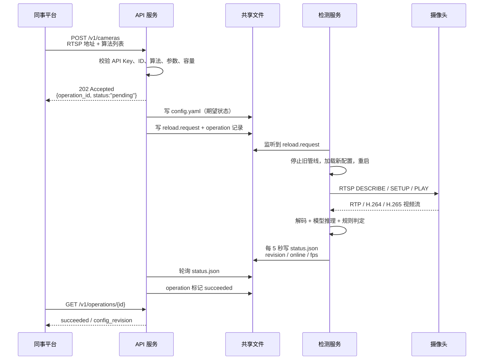
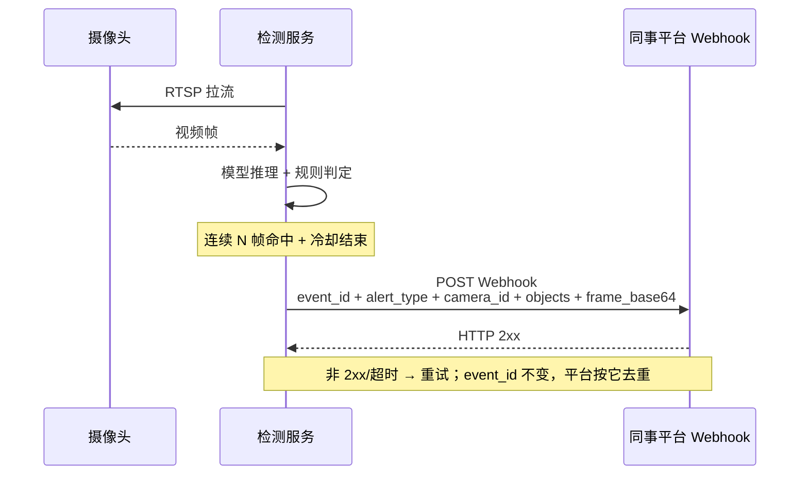

# VideoInspector API 调用流程图与数据说明（v0.1）

> 说明：`api` 和 `detector` 可以是同一台 GPU 服务器上的两个容器，也可以分开部署。  
> 下面用“服务角色”描述，不假设一定是两台物理机。

## 一、先认识几个角色

| 角色 | 对应容器/位置 | 默认端口 | 主要职责 |
| --- | --- | --- | --- |
| 同事平台 | 外部系统 | — | 调 API 管理摄像头/算法；提供 Webhook 地址接收告警 |
| API 服务 | `api` 容器 | 8080（宿主机 18080） | 校验请求、读写配置、管理异步任务、查询状态、探测 RTSP |
| 检测服务 | `detector` 容器 | 无对外 API 端口 | 拉 RTSP、跑模型、判定违规、写状态、推 Webhook |
| 摄像头/流媒体网关 | 现场设备 | 通常 554 | 提供 RTSP 视频流 |
| 共享文件 | `config/`、`runtime/` 卷 | — | API 和检测服务之间的“交接班台账” |

**关键点：API 和检测服务之间不是 HTTP 调用，而是通过共享文件交接。**

```text
config/config.yaml          ← API 写，检测服务读
runtime/reload.request      ← API 写，检测服务监听
runtime/status.json         ← 检测服务写，API 读
runtime/operations/*.json   ← API 读写，记录变更结果
runtime/config-history/     ← API 写，失败回滚用
```

## 二、总览图

```text
┌──────────────┐
│   同事平台    │
└──────┬───────┘
       │ ① HTTPS JSON + API Key
       │    POST/PUT/GET/PATCH/DELETE
       ▼
┌──────────────┐       ② 读写共享文件        ┌──────────────────┐
│   API 服务    │ ◄─────────────────────────► │  config/ runtime/ │
└──────┬───────┘                             └────────┬─────────┘
       │                                              │
       │ ③ probe 时直接连 RTSP                        │ ④ 检测服务读配置
       │    （不经过 detector）                        │    监听 reload.request
       ▼                                              ▼
┌──────────────┐                             ┌──────────────────┐
│ 摄像头/网关   │ ◄──── RTSP 拉流 ──────────── │   检测服务        │
└──────────────┘                             │  （GPU 推理）     │
                                             └────────┬─────────┘
                                                      │ ⑤ Webhook JSON + 证据帧
                                                      ▼
                                             ┌──────────────────┐
                                             │ 同事平台 Webhook  │
                                             └──────────────────┘
```

一句话：

- **API 不转发视频**，只把 RTSP 地址写进配置。
- **检测服务直接拉摄像头**，不经过 API。
- **告警直接从检测服务推给同事平台**，不经过 API。
- API 和检测服务通过 `config/`、`runtime/` 两个共享目录交接。

## 三、场景 A：新增摄像头 + 绑定算法

### 3.1 时序图



### 3.2 每一方传输了什么

| 步骤 | 发送方 → 接收方 | 传输的数据 | 作用 |
| --- | --- | --- | --- |
| ① | 同事平台 → API | HTTP POST，JSON：`id`、`name`、`rtsp_url`、`device_code`、`channel_no`、`source_mode`、`algorithms[]`、`params` | 告诉系统“加哪路摄像头、开哪些算法、参数多少” |
| ② | API → 同事平台 | HTTP 202，JSON：`operation_id`、`status:"pending"` | 表示请求已受理，变更在后台执行 |
| ③ | API → 共享文件 | `config.yaml`、`runtime/reload.request`、`runtime/operations/<id>.json` | 写期望状态，通知检测服务重载 |
| ④ | 检测服务 → 共享文件 | 读取 `config.yaml`；写 `runtime/status.json` | 加载新配置，上报运行状态 |
| ⑤ | 检测服务 → 摄像头 | RTSP 控制信令（DESCRIBE/SETUP/PLAY） | 建立视频会话 |
| ⑥ | 摄像头 → 检测服务 | RTP 包（H.264/H.265 压缩视频） | 提供视频流 |
| ⑦ | 检测服务 → 同事平台 | HTTP POST Webhook，JSON + `frame_base64` | 检测到违规时推送告警 |
| ⑧ | 同事平台 → API | HTTP GET `/v1/operations/{id}` | 查询变更是否成功 |
| ⑨ | API → 同事平台 | JSON：`status`、`config_revision`、`error` | 告知结果；失败会显示回滚原因 |
| ⑩ | 同事平台 → API | HTTP GET `/v1/cameras` | 查询摄像头列表和在线状态 |
| ⑪ | API → 同事平台 | JSON：摄像头配置 + `online`、`fps`、`last_alert_at`、`algorithm_versions` | 给平台展示和排障 |

### 3.3 实现了什么功能

- 同事平台不需要登录 GPU 服务器，也不需要改 YAML。
- API 负责把“业务语言”（加摄像头、绑算法）翻译成检测服务认识的配置。
- 检测服务负责真正拉流、推理、告警。
- 变更失败会自动回滚到上一版配置，避免把整条检测线改挂。

## 四、场景 B：给已有摄像头换算法/调参数

```text
同事平台
  │ PUT /v1/cameras/1824/algorithms
  │ { "algorithms": [
  │     {"id":"no_helmet","params":{"cooldown_seconds":60,"min_detection_count":5}},
  │     {"id":"smoking","params":{"attribute_threshold":0.85}}
  │   ] }
  ▼
API 服务
  │ 校验算法和参数
  │ 生成该摄像头专属的 __cam__ 规则（不改检测代码）
  │ 写 config.yaml + reload.request
  │ 返回 202 + operation_id
  ▼
检测服务
  │ 重启管线，按新规则判定
  │ 写 status.json
  ▼
API 服务
  │ operation 标记 succeeded
  ▼
同事平台
  │ GET /v1/operations/{id}
  ▼
  succeeded
```

| 传输方向 | 数据 | 作用 |
| --- | --- | --- |
| 同事平台 → API | 算法 ID 列表 + 每路参数 | 指定“这路要开什么、严格程度/冷却/连续帧数” |
| API → 共享文件 | 生成 `__cam__...` 规则、更新 `active_rules` | 让检测服务按该摄像头专属参数执行 |
| 检测服务 → 共享文件 | `status.json` | 证明新配置已生效 |
| API → 同事平台 | operation 结果 | 告知成功或回滚 |

注意：

- API 只改“配置”，不直接改检测算法。
- 同一时刻只允许一个变更生效；并发提交会返回 `409 OPERATION_IN_PROGRESS`。
- 每次变更会重启整条管线，所有流中断约 10~30 秒。

## 五、场景 C：查询状态

```text
同事平台
  │ GET /v1/cameras 或 /v1/cameras/{id}
  ▼
API 服务
  │ 读 config/config.yaml
  │ 读 runtime/status.json
  │ 合并：配置 + 在线状态 + 帧率 + 最后告警 + 算法版本
  ▼
同事平台
  │ 200 JSON
  ▼
展示摄像头列表/详情
```

| 传输方向 | 数据 | 作用 |
| --- | --- | --- |
| 同事平台 → API | HTTP GET + API Key | 请求状态 |
| API → 同事平台 | `online`、`last_frame_age_seconds`、`fps`、`last_alert_at`、`algorithm_versions` | 平台展示、排障 |
| API → 检测服务 | **不调用** | 状态来自共享文件，不是实时 RPC |

注意：

- 状态由检测服务每 5 秒写一次，最多有几秒延迟。
- 检测服务停止时，`pipeline` 会变成 `stopped`，`online` 会变 false。
- API 不需要 GPU，也不接触视频流。

## 六、场景 D：RTSP 探测

```text
同事平台
  │ POST /v1/cameras/1824/probe
  ▼
API 服务
  │ 202 + operation_id
  │ 后台从 API 容器直接连摄像头
  │ 优先 ffprobe，失败则 RTSP OPTIONS
  ▼
摄像头
  │ 返回 SDP / 编码 / 分辨率 / 帧率（能拿到多少算多少）
  ▼
API 服务
  │ 写 operation.result
  ▼
同事平台
  │ GET /v1/operations/{id}
  ▼
reachable / resolution / codec / fps / latency_ms
```

| 传输方向 | 数据 | 作用 |
| --- | --- | --- |
| 同事平台 → API | 摄像头 ID | 请求探测 |
| API → 摄像头 | RTSP OPTIONS / DESCRIBE（或 ffprobe） | 检查能不能拉流 |
| 摄像头 → API | SDP、编码、分辨率、帧率 | 返回探测结果 |
| API → 同事平台 | `reachable`、`resolution`、`codec`、`fps`、`latency_ms` | 上线前确认流可用 |

注意：

- 探测**不需要模型、不需要 GPU、不经过检测服务**。
- 推荐流程：先建 `enabled:false` 的摄像头 → probe → 确认可达 → PATCH 启用。

## 七、场景 E：告警推送



### 7.1 Webhook 里有什么

```json
{
  "event_id": "evt_...",
  "schema_version": "1.0",
  "alert_type": "no_vest",
  "camera_id": "1824",
  "camera_name": "ZoneC_Outdoor_001",
  "device_code": "ICC-DEVICE-001",
  "channel_no": "1",
  "timestamp": "2026-10-23T02:15:33.12+00:00",
  "objects": [
    {
      "class": "person",
      "confidence": 0.87,
      "bbox": [840, 210, 1020, 760],
      "attributes": [
        {"class": "no_vest", "confidence": 0.5, "bbox": null}
      ]
    }
  ],
  "frame_base64": "..."
}
```

| 字段 | 意思 |
| --- | --- |
| `event_id` | 每条告警的唯一编号；重试时不变，用来去重 |
| `alert_type` | 告警类型，如 `no_vest`、`no_helmet`、`smoking` |
| `camera_id` | 摄像头 ID，和 API 里的 ID 一致 |
| `device_code` / `channel_no` | ICC 设备编码/通道号（可选） |
| `timestamp` | 告警时间（UTC） |
| `objects` | 违规对象：类别、置信度、bbox、附属属性 |
| `frame_base64` | 证据帧 JPEG 的 Base64；可通过配置关闭 |

### 7.2 实现了什么功能

- 实时告警，不需要同事平台轮询。
- 告警带证据帧，平台可以直接展示。
- 通过 `event_id` 去重，网络重试不会重复记录。
- 可选 HMAC 签名，防止伪造告警。
- **API 挂了不影响告警**：只要检测服务还在跑，Webhook 照常推。

## 八、每个服务到底传了什么、收到什么

| 服务 | 收到 | 发出 | 不做什么 |
| --- | --- | --- | --- |
| 同事平台 | API 的 JSON 响应；Webhook 告警 | API 请求；Webhook 的 2xx 确认 | 不直接拉 RTSP，不跑模型 |
| API 服务 | 同事平台的 HTTPS JSON | JSON 响应；写 `config/`、`runtime/`；probe 时连 RTSP | 不转发视频，不跑模型，不直接推告警 |
| 检测服务 | 读 `config.yaml`；RTSP 视频流；`reload.request` | `status.json`；Webhook 告警；RTSP 控制信令 | 不对外提供管理 API |
| 摄像头 | RTSP 控制信令 | RTP 视频流 | 不做检测 |
| 共享文件 | API/检测服务读写 | — | 不是网络服务，是同一台机器/同一卷上的文件 |

## 九、失败与回滚流程

```text
同事平台
  │ POST/PUT
  ▼
API 服务
  │ 校验通过，写新 config.yaml
  │ 写 reload.request
  ▼
检测服务
  │ 重启管线
  │ 如果模型/RTSP/GPU 出问题 → 子进程退出或状态不更新
  ▼
API 服务
  │ 等待 status.json 超时（默认 90 秒）
  │ 恢复 config-history 里的上一版
  │ 再写 reload.request
  │ operation 标记 rolled_back
  ▼
同事平台
  │ GET /v1/operations/{id}
  ▼
status:"rolled_back" + error 原因
```

关键点：

- 变更不是“改完文件就完事”，要等检测服务确认新配置生效。
- 失败会回滚，不会把旧配置丢掉。
- 回滚也会重启管线，所以仍然有短暂中断。

## 十、一句话总结

```text
同事平台  →  API：下指令、查结果
API       →  共享文件：写配置、写任务
检测服务  →  共享文件：读配置、写状态
检测服务  →  摄像头：拉 RTSP
检测服务  →  同事平台：推 Webhook
```

- **API 是遥控器**：不碰视频，只改配置、查状态、做探测。
- **检测服务是工人**：真正拉流、推理、告警。
- **共享文件是交接班台账**：API 和检测服务不互相 HTTP 调用。
- **摄像头只负责出流**：不做 AI。
- **Webhook 是告警出口**：从检测服务直连同事平台，不经过 API。
